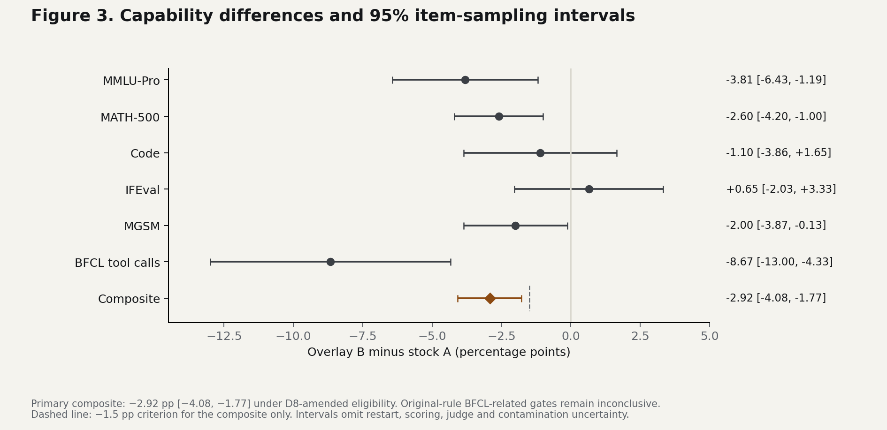
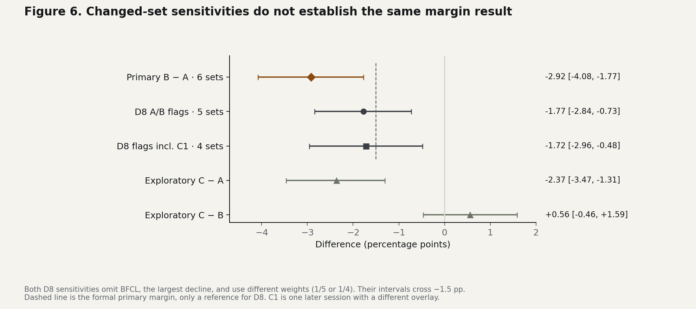

# Qwen3.8 Flash Next: stock versus a refusal-reduction overlay

> **v1.0.1 erratum — 12 November 2026:** outcome-reporting, historical-label and documentation clarifications are recorded in [ERRATA.md](ERRATA.md). Original scores, estimates and intervals are unchanged; [v1.0 remains preserved](https://github.com/alejandro-ventures/qwen3.8-flash-next-ablit-vs-stock/tree/v1.0).

A paired evaluation of a pinned overlay on one GB10. Author: [alejandro-ventures](https://github.com/alejandro-ventures).

The overlay reduced automated refusal labels, while the six-benchmark capability composite fell by **2.92 percentage points** (95% CI **−4.08 to −1.77**). The largest decline was tool calling, particularly parallel calls. Fewer refusal labels did not establish useful task completion.

The beyond-margin finding is conditional on **D8-amended traffic eligibility** and the collected sessions. **Under the original traffic rule, BFCL-related gates, including the primary capability criterion (H1), remain inconclusive.** Excluding BFCL changes the composite to −1.77 pp [−2.84, −0.73], which does not establish the same beyond-margin result. Queue telemetry neither proves nor rules out foreign traffic.

**[Read the full illustrated report](REPORT.md)** · **[Methods and complete tables](docs/TECHNICAL_REPORT.md)** · **[Reproduce the analysis](#reproduce-the-results)**

## What changed



The six task sets have equal weight in the primary composite. The dashed line marks the −1.5 pp preservation criterion for that composite only. Intervals cover item sampling conditional on the collected sessions; they omit restart, scoring, judge and contamination uncertainty.

| Outcome | Observation |
|---|---|
| Capability composite | Stock 88.7%; overlay 85.8%; difference −2.92 pp under amended eligibility |
| Tool calling (BFCL) | 87.3% → 78.7%; parallel calls 80% → 53% |
| Long context | Difference 0.00 pp [−2.50, +2.50]; meets the −5 pp criterion without establishing equality |
| Exact copying | Thinking-on stock outputs were valid JSON but copied incorrect amounts; cause unestablished |
| Refusal labels | Fewer overlay refusals across the reported classifiers; useful completion was not independently verified |
| Speed | Slower prose and faster code on two fixed prompts; no general speed effect established |

## Sensitivity and scope



The five- and four-set sensitivities omit BFCL and change the benchmark weights. C1 uses a different overlay and is one later exploratory session. The [full report](REPORT.md) explains the traffic rules, selected post-hoc judge audit, truncation mismatch and D1–D17 deviations.

The primary collection order was A1–B1–B2–A2, with fresh server restarts and the same pinned serving build. Greedy decoding used task-specific thinking settings. This is one deployment and one pinned B overlay; the results do not establish a general causal effect of abliteration or a deployment recommendation.

## What is in this repository

- [REPORT.md](REPORT.md): complete narrative, methods, results, discussion and technical appendix, with seven standalone figures.
- [figures/](figures/): PNG/SVG figures, generation code, exact plot values and source/output hashes.
- [Technical report](docs/TECHNICAL_REPORT.md): full original tables and analysis specification.
- [analysis/](analysis/): scores, derived numeric/label inputs and reproducible aggregate analysis.
- [Protocol](PROTOCOL.md), [deviations](DEVIATIONS.md), [request profiles](docs/REQUEST_PAYLOADS.md) and [dataset notices](docs/DATASET_LICENSES.md).

The PDF edition is maintained outside this repository. This repository presents the complete report as native Markdown and standalone figures.

## Reproduce the results

```bash
python -m pip install -r analysis/requirements.txt
python -B analysis/run_all.py
```

```bash
python -m pip install -r figures/requirements.txt
python -B figures/generate_figures.py
```

Reference aggregate-output hashes were generated on Linux with Python 3.11.2 and the pinned dependencies. Another Python runtime or newline convention can change metadata or bytes without changing scientific values; see the [reproduction record](docs/REPRODUCTION.md).

These commands recompute aggregate arithmetic and render figures from published inputs. They do not contact a model, repeat live collection, score withheld replies or re-judge the original responses. See [the reproduction record](docs/REPRODUCTION.md) and [technical report](docs/TECHNICAL_REPORT.md).

## Attribution and disclosure

The study uses [MiaAI-Lab's recipe at 20e15e4](https://github.com/MiaAI-Lab/Qwen3.8-Flash-Next-Single-DGX-Spark-TensorFold/tree/20e15e4) and [drowzeys's pinned overlay](https://huggingface.co/drowzeys/keys-Qwen3.8-Flash-Next-NVFP4-FP4-QAD-house-qsa-L3-47). Software, checkpoint and overlay pins are in the technical report.

Harness development, analysis and writing used AI assistance, including drafting and model review. Review did not independently repeat live collection or re-judge withheld responses. Original study code is MIT; report text/tables and synthetic items are CC BY 4.0 subject to upstream rights and notices. See [NOTICE.md](NOTICE.md) and [dataset licences](docs/DATASET_LICENSES.md). Corrections should be recorded visibly in an erratum.

Suggested citation: **alejandro-ventures. Refusal reduction and capability in Qwen3.8 Flash Next.** Include the version/tag used. Third-party notices remain applicable.
