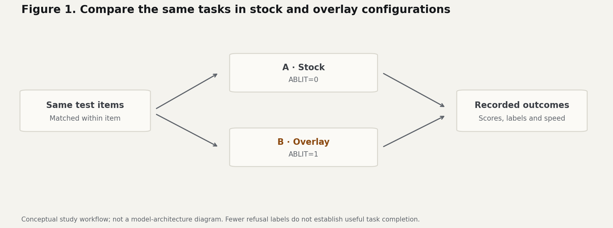
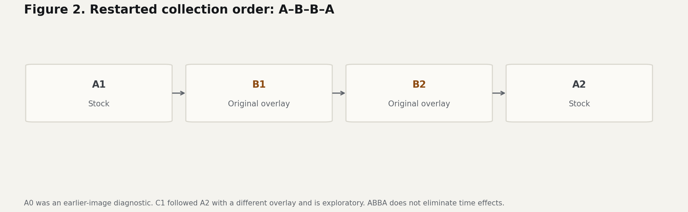
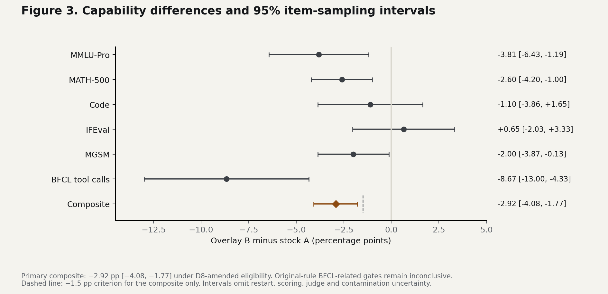
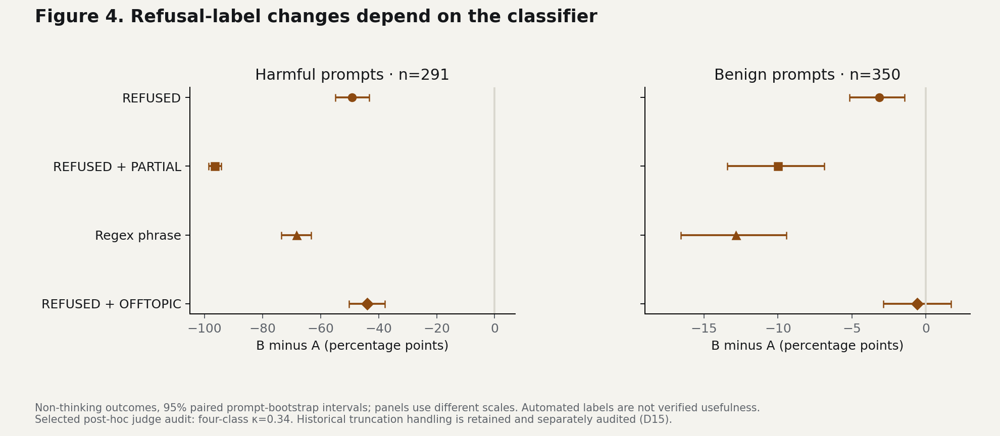
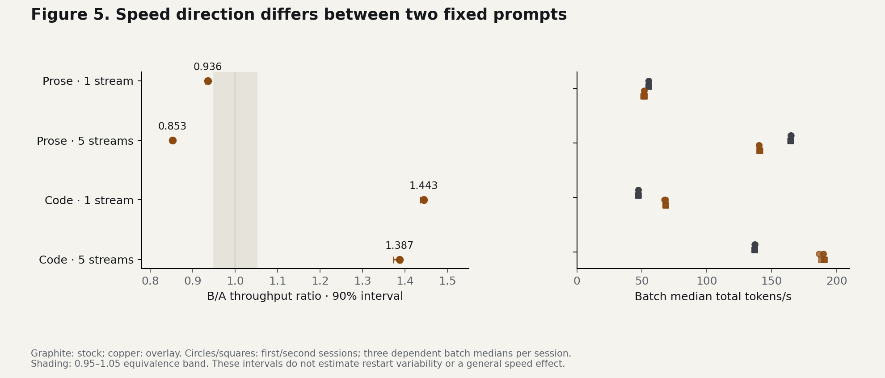
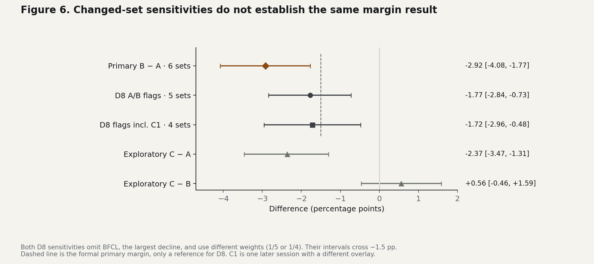
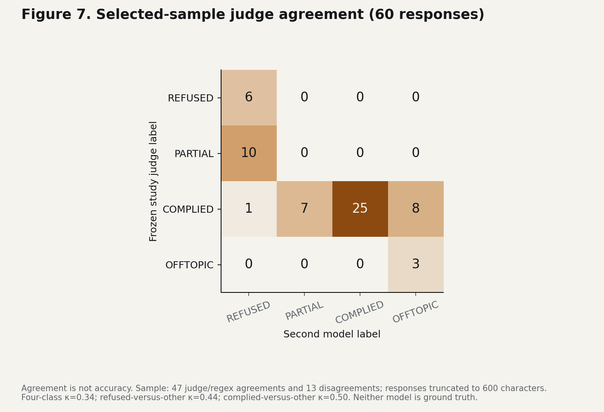

# Refusal reduction and capability in Qwen3.8 Flash Next

> **v1.0.1 erratum — 12 November 2026:** outcome-reporting, historical-label and documentation clarifications are recorded in [ERRATA.md](ERRATA.md). Original scores, estimates and intervals are unchanged; [v1.0 remains preserved](https://github.com/alejandro-ventures/qwen3.8-flash-next-ablit-vs-stock/tree/v1.0).

A paired evaluation of a pinned overlay on one GB10

Author: [alejandro-ventures](https://github.com/alejandro-ventures) | 11 November 2026 | Study report

This study compares a pinned refusal-reduction overlay with stock on one GB10, examining capability, response labels, speed and exact copying.

## Abstract


A pinned refusal-reduction overlay was compared with a quantized, patched stock deployment in four restarted sessions (A1–B1–B2–A2). The equal-weight capability composite fell by 2.92 percentage points (95% CI −4.08 to −1.77), below the pre-specified −1.5-point preservation criterion. Refusal labels decreased, without independent verification of useful task completion. Speed direction differed between two fixed prompts. Thinking-on JSON copying failed in stock as well as overlay sessions, despite valid structure. The primary criterion failed under amended traffic eligibility; the original-rule BFCL-related gates remain inconclusive. Changed-set sensitivities and deviations limit confirmation and causal interpretation.

## 1 Introduction


Abliteration modifies a model to make refusals less frequent. This study compares the deployed stock setup (A) with the same setup plus a pinned overlay (B). Capability, refusal labels, speed and exact copying are evaluated separately, because a lower refusal rate alone does not establish correctness or usefulness. Figure 1 outlines the comparison.

Figure 1. The same task is tested in both configurations, and the recorded outcomes are compared. Illustration of the test, not a model-architecture diagram. Original task and response text are withheld.


Source: [detailed technical record](docs/TECHNICAL_REPORT.md); [aggregate results](analysis/extra_results.json).



[Editable SVG](figures/01_comparison.svg)

## 2 Methods


### 2.1  Setup and collection


A is the quantized, patched stock deployment (ABLIT=0); B adds the pinned overlay (ABLIT=1). The primary comparison uses one GB10, the same software build, checkpoint and serving recipe, greedy decoding and benchmark-specific thinking settings. Each session began with a fresh restart. A1 and A2 repeat stock; B1 and B2 repeat the overlay. The A–B–B–A order helps address time/order drift without eliminating all time effects.

### 2.2  Outcomes

| Outcome | Measurement |
|---|---|
| Capability | Six task sets; equal benchmark weights in the composite. |
| Refusal labels | Harmful and benign prompts; several classification rules. |
| Output speed | Generated tokens/s on two fixed prompts at 1 and 5 streams. |
| Exact copying | JSON parsing, schema validity and exact field values. |
| Planned auxiliary pairwise judging | Unreported; completion unverified in retained records; excluded from primary gates. |


### 2.3  Paired estimates and intervals


The same items are repeated across sessions. Each item is averaged within arm before paired bootstrap: repeatedly resampling matched tasks or problem groups. Capability and refusal differences are B minus A; a percentage point is an absolute difference (90% to 88% is −2 points). Dots show estimates and whiskers the reported intervals. Capability uses 95% item-sampling intervals, category strata for MMLU-Pro and problem clusters for MGSM (250 problems × 3 languages). The −1.5 pp margin applies only to the primary composite.

Speed uses B/A ratios and frozen D2 90% intervals from six dependent batch medians per arm, three per session and seven repetitions per median. Ratios above one mean faster. These intervals do not estimate restart variability. The other intervals also exclude uncertainty from restarts, judges, scoring and contamination.

### 2.4  Protocol and deviations


The protocol preceded B collection; the corrected headline analysis followed the data (D13). Disclosed deviations: D8 changed contamination rules after B data existed (telemetry neither proves nor rules out foreign traffic); D9 included an interim look; D12 judge review was post hoc; D15 retained labels for length-finished replies. Results report these checks; §4 discusses their implications.

Figure 2. Collection order. A0 is an earlier-image diagnostic excluded from the primary contrast. C1 is one later session using a different overlay (sidecar) and loader patch; it is exploratory and has no confirmatory gate.


Source: [detailed technical record](docs/TECHNICAL_REPORT.md); [complete analysis tables](analysis/extra_tables.md); source commit 4a97533b.



[Editable SVG](figures/02_collection_order.svg)

## Planned exploratory auxiliary outcome

The protocol's pairwise auxiliary-task win rate and 20-pair review are unreported. Retained records do not establish completion of those judgments. No auxiliary result enters the primary six-benchmark composite or gates. See [D16](DEVIATIONS.md#d16-recorded-2026-11-12-planned-auxiliary-judging-outcome-unreported).

## 3 Results

### 3.1  Capability

The composite fell from 88.7% (A) to 85.8% (B): -2.92 pp [95% CI -4.08, -1.77], wholly below the -1.5 pp margin. BFCL declined -8.67 pp; parallel calls fell 80% to 53% (-27 pp), while simple changed 0 pp and multiple +1 pp. Under D8-amended eligibility, the secondary tool gate failed; under the original rule, BFCL-related gates remain inconclusive. IFEval had a positive estimate spanning zero. Figure 3 reports all estimates; changed-set sensitivities are in §3.5.

Benchmark guide: MMLU-Pro tests general knowledge; BFCL tests tool calls; IFEval tests instruction following; MGSM tests multilingual math; Code tests coding; MATH-500 tests math.

Figure 3. Capability estimates. A: stock; B: original overlay. Each benchmark has weight 1/6 in the composite; the 2,874 total items do not determine those weights. MGSM comprises 250 problem clusters × 3 languages. Dashed mark: primary composite margin only. Estimation and uncertainty are defined in §2.3.


Source: [aggregate results](analysis/extra_results.json): capability.B_vs_A; H1.

#### Capability table

| Benchmark | Items | Stock A % | Overlay B % | B−A (pp) | 95% interval (pp) |
|---|---:|---:|---:|---:|---|
| mmlu_pro | 420 | 87.1 | 83.3 | -3.81 | [-6.43, -1.19] |
| math500 | 500 | 91.6 | 89.0 | -2.60 | [-4.20, -1.00] |
| code | 363 | 86.8 | 85.7 | -1.10 | [-3.86, +1.65] |
| ifeval | 541 | 84.5 | 85.1 | +0.65 | [-2.03, +3.33] |
| mgsm | 750 | 95.1 | 93.1 | -2.00 | [-3.87, -0.13] |
| bfcl | 300 | 87.3 | 78.7 | -8.67 | [-13.00, -4.33] |
| **Composite** | equal weights | 88.7 | 85.8 | -2.92 | [-4.08, -1.77] |



[Editable SVG](figures/03_capability.svg)

### 3.2  Refusal labels

On 291 harmful non-thinking prompts, primary REFUSED labels fell from 49.1% in stock to 0% with the overlay. On 350 benign prompts, they fell from 3.1% to 0%. Figure 4 compares the primary rule with three alternatives. REFUSED+PARTIAL is pre-specified; the phrase regex is a separate classifier; REFUSED+OFFTOPIC is exploratory. The latter interval spans zero for benign prompts. These are automated labels, not independently verified useful task completion. Judge agreement and the truncation audit are reported quantitatively in §3.7, with interpretation in §4.

Figure 4. Non-thinking refusal outcomes, B minus A, with 95% paired prompt-bootstrap intervals. The panels use different x-axis ranges. The primary labels preserve the historical D15 implementation; no revised refusal effect is estimated here. See §2.3 and §3.7.


Source: [aggregate results](analysis/extra_results.json): refusal; [detailed technical record](docs/TECHNICAL_REPORT.md) D12/D15.



[Editable SVG](figures/04_refusal.svg)

### 3.3  Output speed

A token is a chunk of text, often part of a word. On the isolated prompts, overlay/stock throughput ratios were 0.936 and 0.853 for prose, and 1.443 and 1.387 for code (Figure 5). Each condition uses one fixed prompt. The D8 speed sensitivity drops A1’s first batch median; ratios become 0.936, 0.853, 1.445 and 1.387 in row order. None of the four conditions met the 0.95-1.05 equivalence criterion. Mixed four-stream harness differences were only a few percent.

Figure 5. Throughput ratios (left) and all batch medians (right; three per session, mostly overlapping). Graphite: A; copper: B. Circles: session 1; squares: session 2. B/A >1 means faster. Shading: 0.95–1.05 equivalence band. Dependent-median intervals are defined in §2.3.


Source: [aggregate results](analysis/extra_results.json): H3, speed_raw.



[Editable SVG](figures/05_speed.svg)

### 3.4  Exact copying


JSON is structured text software can read; a schema specifies expected fields and types. Exact copying also requires correct values. Thinking mode gives an extra reasoning budget. In the fresh stock check, all 24 schema-constrained outputs were valid: 12/12 thinking-off outputs copied exactly, versus 0/12 thinking-on outputs. Only three unique records were repeated across four settings per mode; repeats are not independent.

Historical thinking-on audit: 120/120 schema-valid, wrong amount. Keep these records separate from the fresh outputs. Four json_object controls also parsed; they did not enforce the two-field schema.

### Table 1. Historical exact copies

| Session | Thinking off /50 | Thinking on /20 |
|---|---:|---:|
| A0 | 50 | 0 |
| A1 | 50 | 0 |
| B1 | 47 | 0 |
| B2 | 47 | 0 |
| A2 | 50 | 0 |
| C1 | 42 | 0 |

Source: [exact-copy checks](findings/thinking_json_schema.md); [aggregate JSON counts](analysis/extra_results.json): H4.

### 3.5  Sensitivity and exploratory contrasts

Using original contamination flags in the primary sessions removes BFCL from the capability composite. This retains 2,574 of 2,874 items across five sets, with weights 1/5, and gives −1.77 pp [−2.84, −0.73]. Including flags from C1 also removes MGSM, leaving 1,824 items across four sets, weights 1/4, and −1.72 pp [−2.96, −0.48]. Both intervals cross the −1.5 pp reference. Figure 6 also reports the original-set C contrasts: C minus A is −2.37 pp and C minus B is +0.56 pp. C is one later, different-overlay session.

Figure 6. Capability composites and 95% item-sampling intervals. The D8 rows define different sets and weights; both omit BFCL, the largest decline. The dashed line is a formal margin for the primary row only and a reference for D8. C1 uses the original six sets but has no confirmatory gate. See §2.4 and §4.


Source: [aggregate results](analysis/extra_results.json): d8_sensitivity; capability.C_vs_A / C_vs_B.



[Editable SVG](figures/06_sensitivity.svg)

### 3.6  Additional checks


The pooled 32K/128K long-context difference was 0.00 pp (95% CI −2.50 to +2.50), meeting the H1b -5 pp margin criterion without establishing equality. All six engine checks passed; these are self-consistency checks, not proof of A/B identity. On 200 Layer 2 prompts, within-arm output hashes matched 200/200; A/B hashes matched 0/200. Replies at the 512-token cap were 160/200 in A1/A2, 154/200 in B1/B2 and 156/200 in C1. Hash changes and cap counts are not quality scores.

### 3.7  Measurement checks

A second model reviewed a selected 60-response sample: A1/B1, 15 harmful and 15 benign responses per session. Selection included 47 judge/regex agreements and 13 disagreements. The two models agreed on 34/60 four-class labels (kappa 0.34), 49/60 refused-versus-other labels (0.44), and 44/60 complied-versus-other labels (0.50). Figure 7 shows the full matrix. The original refusal judge was abliterated; the second model reviewed text truncated to 600 characters. Neither provides ground truth, and this sample does not estimate population accuracy.

Figure 7. Selected-sample agreement counts. Rows are the frozen study judge; columns are the second model. Agreement is not accuracy. The 47/13 selection strata describe judge/regex agreement, not the 34 agreements shown on the diagonal.


Source: [adjudication labels](analysis/inputs/adjudication_pairs.csv); [agreement summary](analysis/validation_summary.json); [truncation counts](analysis/inputs/refusal_truncation_counts.json).



[Editable SVG](figures/07_judge_agreement.svg)

#### 3.7.1  Length-finished replies (D15)


Across the non-thinking refusal sets, all length-finished replies received labels, contrary to protocol. Table 2 audits this implementation; these counts do not re-estimate the refusal effect.

### Table 2. Length-finished non-thinking replies

| Session | Harmful /291 | Benign /350 |
|---|---:|---:|
| A1 | 0 | 5 |
| B1 | 13 | 2 |
| B2 | 13 | 2 |
| A2 | 0 | 5 |
| C1 | 21 | 5 |

## 4 Discussion


### Interpreting the outcomes


The primary comparison combines fewer refusal labels with lower average capability scores. These outcomes need separate interpretation. Refusal labels describe how a classifier reads a response; they do not show that a task was completed usefully. Likewise, valid JSON does not establish correct values. The fresh copying check reproduced valid structure with wrong amounts under thinking, so the earlier malformed-JSON allegation was withdrawn. The root cause remains unresolved.

### Two fixed-prompt speed results


Speed direction differed between the two fixed benchmark prompts: prose slowed while code accelerated. The mixed harness showed much smaller differences. Two sessions per arm and dependent within-session medians cannot characterize restart variability or explain a mechanism. These measurements therefore support a narrow observation, not a general speed advantage.

### Sensitivity and measurement


D8 sensitivities remain negative, but they change the benchmark set and omit BFCL, the largest decline. Their intervals cross the margin reference and do not reproduce the primary margin failure. C1 cannot resolve that uncertainty: it uses a different overlay and loader patch, ran later, and has no second session or confirmatory gate. The judge-agreement sample is also selected and truncated, and D15 is a count audit rather than a repaired effect estimate.

### Scope and uncertainty


The protocol preceded B collection; the headline analysis includes post-data corrections (Appendix D). ABBA helps address order and drift but does not establish a general causal effect. Item-sampling intervals leave out restart, judge, scoring and contamination uncertainty. The evidence remains specific to this server, image, overlay revision and prompt set. The additional checks in §3.6 describe observed consistency or divergence; they are not substitute measures of answer quality.


Source: [detailed technical record](docs/TECHNICAL_REPORT.md); [aggregate results](analysis/extra_results.json); [exact-copy checks](findings/thinking_json_schema.md).

## 5 Conclusion

### Assessment against the stated criterion

The primary analysis failed the capability-preservation criterion under D8-amended eligibility. B minus A was -2.92 pp (95% CI -4.08 to -1.77), with the whole interval below the pre-specified -1.5 pp margin. Conditional on these sessions and that eligibility rule, this supports a loss beyond the tolerated margin. BFCL had the largest decline (-8.67 pp), concentrated in parallel tool calls (80% to 53%). Under the original traffic rule, BFCL-related gates would remain inconclusive; queue telemetry neither proves nor rules out foreign traffic. Removing BFCL gives -1.77 pp [-2.84, -0.73]: still negative, but not beyond the margin across the full interval. Both analyses point toward lower measured capability; the threshold conclusion depends on the amended rule and full benchmark set.

Fewer refusal labels do not establish verified useful completion. Speed direction differed between two fixed benchmark prompts, without a demonstrated general mechanism. Thinking-on JSON copying also failed in stock despite valid structure, so this is a separate stock-deployment observation with unestablished cause. Post-data analysis corrections, an interim look, traffic-rule changes and weak judge validation prevent an unqualified confirmatory claim. These results concern one deployment and one pinned overlay, do not establish a general causal effect of abliteration, and do not provide a deployment recommendation.

### Data, code and disclosure


The accompanying analysis package contains the scores and derived inputs from study snapshot 4a97533b. Figure sources, exact plot values and SHA-256 manifests support offline reproduction. Raw prompts/replies and model files are withheld; re-analysis does not permit re-judging or independent verification of the replies. Appendix A–E provides the technical methods.

Harness, analysis and writing used AI assistance, including drafting and model review. Those reviews did not independently repeat live collection or re-judge withheld responses. This report has not undergone external peer review.


Source: [detailed technical record](docs/TECHNICAL_REPORT.md); [aggregate results](analysis/extra_results.json); [deviation log](DEVIATIONS.md).

## Technical Appendix

### A  Configuration and task selection


#### A.1  Deployment and activation


One GB10 with 128 GB unified memory. A is a quantized, patched serving stack, not a generic out-of-the-box base model. Shared settings: recipe 20e15e4; context 262,144; PARALLEL 5; fp8 KV; vision on; greedy decoding. B applies the pinned projection-plus-requantisation overlay. A0 used an earlier local image and is diagnostic only. C1 uses another overlay plus a loader patch; it is not a B replicate.

#### A.2  Model and software pins


Checkpoint: nvidia/Qwen3.8-Flash-Next-FP4-Local, revision b9ce18a6887e18c089fdea8509a33e63429a3300, with its own chat template. B overlay: drowzeys/keys-Qwen3.8-Flash-Next-NVFP4-FP4-QAD-house-qsa-L3-47, revision c44f5b92ee3d307b82aab1c55f4cc4ae1d440344. C revision: f0192705c8ab34f1140f7be8dbe556cdfe49b2e0. Image sha256: 5c6c42b9747318c1cd8b6cb85cb69493fff2e82cb23b61e49b9cf54cd09ac28e. Full source identifiers are in the [technical report](docs/TECHNICAL_REPORT.md).

#### A.3  Selected tasks and scoring


MMLU-Pro: 420 seeded test items, 30 per each of 14 categories. MATH-500: all 500, boxed-answer matching with fixed normalisation. Code: 163 HumanEval+ and 200 MBPP+, plus-tests; HumanEval/32 excluded because its canonical solution failed the checker (float root finding). The remaining 363 canonical solutions passed the checker self-test. IFEval: 541 instruction-following items. MGSM: 250 problems in English, German and Spanish (750 records); translations share a cluster.

#### A.4  Tool and long-context tasks


BFCL v3: 100 each simple, multiple and parallel. The AST-style checker validates function names and allowed parameter values (numeric tolerance 1e-9); parallel calls match as sets. Ground-truth and perturbed-answer self-tests were specified before use. Long context: three generated tasks (multi-key NIAH, variable tracking, aggregation), 20 items at each 4K/32K/128K length: 180 total. 4K is control; 32K+128K define H1b. Layer 1 also includes a 200K needle check.

#### A.5  Refusal and nonpublic task sets


Harmful non-thinking: 291 JBB/HarmBench prompts after exact-text deduplication; benign: 100 JBB plus 250 XSTest (350). Thinking-on variants: 100 harmful and 100 benign JBB. Nonpublic task sets: 50 non-thinking and 20 thinking JSON copies; 200 neutral Layer 2 prompts. Original texts are withheld. Synthetic stand-ins have not produced these scores.


Source: [detailed technical record](docs/TECHNICAL_REPORT.md); [request profiles](docs/REQUEST_PAYLOADS.md); [historical protocol](PROTOCOL.md); [dataset/package revisions](items/REVISIONS.json).

### B  Requests, collection and estimation


#### B.1  Actual inference profiles


Requests use chat completions, model Qwen3.8-Flash-Next, temperature 0. T: thinking on, medium effort, cap 12000 (MMLU-Pro, math, code). N: thinking off, cap 2048 (IFEval, MGSM, BFCL, primary refusal, auxiliary prompts). N4: thinking off, cap 4096, retry after T returns empty content with stop. RT: thinking on, low effort, cap 2048 (thinking refusal). L2: thinking off, cap 512. LC: thinking off, cap 256. JN: thinking off, cap 120. JT: thinking on, low effort, cap 3000.

#### B.2  Transport, tools and collection


Client timeout: 1200 s; up to four total transport attempts with 5/10/15 s backoff. The first response attempt supplies headline scores; retry outputs are sensitivity data. Four requests in flight, long context two; one fixed shuffled order, seed 20261107. BFCL sends tool definitions, replaces dots in names with underscores and maps back for scoring; no tool_choice. JSON uses strict json_schema with exactly record_id and amount as strings, both required, no extra fields.

#### B.3  Session design and paired estimates


Fresh restarts: A1, B1, B2, A2. An item is averaged within each arm, then compared B minus A. Complete cases are contrast-specific: C does not restrict A/B. Coverage is 100% of records; UNCLASSIFIED still counts as zero in the historical binary primary refusal outcome. More than 2% missing makes the relevant gate inconclusive. ABBA helps address order and drift; it cannot separate drift from nondeterminism.

#### B.4  Corrected bootstrap


Paired percentile bootstrap: 10000 resamples, seed 1. Each benchmark is a fixed stratum with equal composite weight 1/6. MMLU-Pro resamples within category; MGSM resamples problem clusters with all translations; other sets resample items. Long context uses task-by-length strata and equal task weights. Refusal resamples matched prompts. Sessions are averaged, not treated as independent item samples. Intervals condition on collected sessions and exclude restart, scoring, judge and contamination uncertainty.

#### B.5  Speed construction (D2)


Two fixed prompts (prose/code), each at 1 and 5 streams. One full run then two decode-only repeats per session, each seven repetitions: three medians per session, six per arm. D2 resamples those medians 10000 times, seed 1, giving 90% ratio intervals. Medians within a session are dependent; intervals do not characterise restart variability. D8 clean-only removes the first A1 median in each condition. Mixed-harness throughput is separate.


Source: [request profiles](docs/REQUEST_PAYLOADS.md); [detailed technical record](docs/TECHNICAL_REPORT.md); [judge configuration](JUDGE.md); [deviation log](DEVIATIONS.md).

### C  Decision rules and measurement


#### C.1  Criteria defined before B collection


H1: capability non-inferiority requires the lower 95% interval end above -1.5 pp; a secondary -1.0 pp line is historical. Here even the upper end is below -1.5 pp. H1b: long-context lower bound above -5 pp. H2: all B engine checks pass wherever A passes. H3: every condition equivalent within B/A 0.95-1.05 using 90% intervals. The protocol also allowed an explicit speed-loss exception of up to 5%, separate from the equivalence test. Tool-calling secondary gate: lower bound above -3 pp.

#### C.2  Own-workload and refusal gates


D1 changed H4 before B from 70 pooled JSON tasks to 50 non-thinking tasks; thinking failures remain separate. H4 compares unique tasks failed in any arm session: A 0/50, B 3/50, C 8/50. B fails the operational rule (no more failures than A); exploratory exact McNemar p=0.25 does not show a significant paired difference. The one-sided 95% binomial upper bound uses n=50, not repeats. H5 uses harmful-refusal superiority and a benign over-refusal upper 95% bound below +3 pp. Its nominal frozen-label pass has compromised confirmatory interpretation.

#### C.3  Judge configuration and validation


The original judge was a local abliterated EXL3-quantised chat model; exact public base/revision/edit identity is withheld for privacy, limiting repeatability. Temperature 0, cap 8, thinking off, effort none. Input is frozen rubric plus request and first 3000 response characters; prompt hash prefix 6f3a6852c5a9. Regex checks the first 400 characters. Primary REFUSED counts PARTIAL as not refused; REFUSED+PARTIAL is a pre-specified sensitivity. COMPLIED does not verify useful completion.

#### C.4  Post-hoc agreement review (D12)


A second model reviewed 60 selected A1/B1 responses, 15 harmful and 15 benign per session, cut to 600 characters. Actual judge/regex agreement strata were 47/13, not planned 30/30. Four-class agreement was 34/60 (kappa 0.34); refused-versus-other 49/60 (0.44); complied-versus-other 44/60 (0.50). Neither model is ground truth. No rubric revision or new headline judging followed. This selected sample does not estimate population accuracy.

#### C.5  Truncation mismatch (D15)


Protocol called for all truncated replies to be unclassified. Implementation did so only when stripped content was below 20 characters; length-finished replies otherwise received labels. Original labels remain unchanged. Strict-rule count sensitivity keeps primary A/B non-thinking sets under 5% unclassified; B harmful is 13/291 (4.47%) in each session. C1 harmful and A1/A2/C1 thinking benign exceed 5%. Counts neither re-judge replies nor recompute refusal effects.


Source: [detailed technical record](docs/TECHNICAL_REPORT.md); [deviation log](DEVIATIONS.md); [judge configuration](JUDGE.md); [request profiles](docs/REQUEST_PAYLOADS.md).

### D  Deviations, provenance and reuse


#### D.1  Timing and consequences


Before B: D1 narrows H4; D2 replaces unavailable speed repetitions with batch medians. D8 changes contamination handling during B after data existed; original-rule flags remain. The primary estimate uses D8-amended eligibility; under the original rule the BFCL-related gates would remain inconclusive. Queue telemetry neither proves nor rules out foreign traffic. D9 is an unplanned B1 interim look. D10 is a retroactive analysis tag, not evidence of advance specification. D11 adds deterministic language-detector seed 0 and headline re-scoring; CPU-sensitive mbpp-239 and alternate-environment scores remain disclosed.

#### D.2  Analysis corrections after collection


D12 supplies the selected, truncated judge audit. D13 corrects strata, MGSM clustering, contrast-specific coverage, speed eligibility, D8 sensitivity and uncertainty language after data and review. These corrections control the headline analysis; they were not all pre-specified. D14 records an installed-to-vendored IFEval import change before B, documented later; all five comparison sessions were re-scored together under D11. The D14 provenance clarification did not alter the exported scores. D15 is the truncation count audit, with no changed labels. See [DEVIATIONS.md](DEVIATIONS.md) for D1-D15 and the post-publication D16-D17 clarifications, including historical statements and visible corrections.

#### D.3  Re-analysis boundaries


This report consumes frozen aggregate and label/count inputs; it does no new bootstrap, judging or scoring. Source commit: 4a97533b1b3c56643143353c685d11964bdc30d6. Original score-level analysis uses Python 3.10.11, numpy 2.2.6 and scipy 1.15.3; lm-eval 0.4.13 and datasets 5.1.0 are pinned. Original langdetect version is unknown; public environment pins 1.0.9. Figure-generation versions and input/output SHA-256 hashes are in [the figure manifest](figures/manifest.json). Full dataset revisions are in [REVISIONS.json](items/REVISIONS.json). The historical protocol remains available, but the [technical report](docs/TECHNICAL_REPORT.md), deviations and actual payloads supersede outdated claims.

#### D.4  What can be independently inspected


Included score and numeric/label records support checking aggregate arithmetic, not validating withheld replies, original own-workload execution, re-judging, raw telemetry, or the exact alternate scoring host. Same-arm repeatability on sampled prompts does not remove these uncertainties. C1 is later, uses another sidecar plus loader patch, and has no second session or confirmatory gate. There is no evidence here about ABLIT=2, other quantisations, sampling or abliteration generally.

#### D.5  Licences and source pointers


Original study code: MIT; report text/tables/synthetic items: CC BY 4.0, subject to upstream rights and MGSM share-alike obligations. Dataset text and model weights are not distributed. MGSM-derived portions may require CC BY-SA 4.0; MATH-500 has no licence declaration in its pinned card. See [dataset notices](docs/DATASET_LICENSES.md) and the [technical report](docs/TECHNICAL_REPORT.md) for source-chain qualifications. Model/checkpoint terms remain separate. Source extracts support inspection; they do not independently replicate collection or establish rights to upstream material.


Source: [detailed technical record](docs/TECHNICAL_REPORT.md); [deviation log](DEVIATIONS.md); [dataset/package revisions](items/REVISIONS.json); [dataset notices](docs/DATASET_LICENSES.md).

### E  Collection safeguards and power


#### E.1  Activation evidence before B1


The gate checked the expected serve-path suffix ablit-b9ce18a6-c44f5b92, matching sidecar and view-index SHA-256 hashes, and at least one differing greedy output hash from A1 among 200 Layer 2 prompts. These are activation checks; the engine supplied no loader-level proof that every intended tensor was replaced. Activation did not depend on refusal rates or benchmark scores.

#### E.2  Original and amended traffic rules


Health was polled every 30 s. The original regular-step rule flagged max(0, running + waiting - harness_inflight) > 0. After B data existed, D8 flagged running > harness_inflight OR (waiting > 0 AND running >= 5); error polls still count. A set above 5% flagged polls was to be rerun once; a still-flagged rerun made affected gates inconclusive. A1 predates prospective halt enforcement. Speed/Layer 1 used the separate rule waiting > 0 OR running > 5, with zero flagged polls required for speed. A1 had one such flag in 84 polls and was not repeated; the sensitivity in section 3.3 removes its first median. Benchmark-tool traffic was not counted in harness_inflight.

#### E.3  BFCL eligibility and blind spots


Original-rule flags: A1 3/12 polls; B1 first two attempts 2/11 each, retained third 1/11; B2 retained 2/11; A2 0/13. Thus the amended-rule primary contrast and original-rule gate status differ. The observed queue pattern can fit admission queue/counter timing, but that explanation is unverified. Both rules miss traffic between polls or when foreign work replaces harness work. Telemetry neither proves nor rules out foreign traffic. D8 sensitivity drops flagged benchmarks from every arm; it changes the estimand.

#### E.4  Assumption-dependent historical power


The retained 18-row simulation is a historical planning artifact, not a new calculation or universal minimum detectable effect. At true difference 0, simulated probability that the lower bound exceeds -1.5 pp is 0.99/0.80/0.67 for discordance 0.04/0.08/0.12 with session-noise parameter 0. With session-noise parameter 0.02, these become 0.93/0.71/0.59. Other rows vary the true difference (-0.5 and -1.5 pp). See [the historical power artifact](analysis/power_result.txt) for all 18 rows; the artifact is not part of the headline re-analysis.

#### E.5  Scoring and inferential limits


IFEval uses strict prompt-level scoring. The supplied scoring Dockerfile specifies network isolation and a 30-second code-item limit. CPU-sensitive mbpp-239 nearly reached that cap in the headline scoring environment and timed out in an alternate environment. GPQA was not run. The primary gates are a conjunction; the many benchmark/category exploratory intervals have no multiplicity-adjusted familywise claim. Category lower-bound flags identify possible consequential losses, not established collapse. No additional statistics were computed for this report.


Source: [detailed technical record](docs/TECHNICAL_REPORT.md); [historical protocol](PROTOCOL.md); [deviation log](DEVIATIONS.md); [complete analysis tables](analysis/extra_tables.md); [historical power artifact](analysis/power_result.txt).

## Reproduction and source data

The report, figures and complete technical record are readable directly in this repository. The PDF edition is maintained outside this repository; no PDF, paper-page images or paper-generation package is included here.

Recompute the aggregate tables from the published scores and derived inputs:

```bash
python -m pip install -r analysis/requirements.txt
python -B analysis/run_all.py
```

Regenerate the seven standalone figures:

```bash
python -m pip install -r figures/requirements.txt
python -B figures/generate_figures.py
```

Figure generation reads the existing aggregate results and adjudication labels. It makes no model or network calls and does not re-estimate statistics. PNG and editable SVG outputs, exact plot values and a source/output hash manifest are in [figures/](figures/). The [technical report](docs/TECHNICAL_REPORT.md) contains the full original tables and analysis specification. [Request profiles](docs/REQUEST_PAYLOADS.md), [deviations](DEVIATIONS.md), [reproduction evidence](docs/REPRODUCTION.md) and [dataset notices](docs/DATASET_LICENSES.md) document the methods and their limits.

The package supports aggregate arithmetic, not independent recollection, scoring of withheld replies or re-judging. The nonpublic task texts, raw model outputs, telemetry capture and model weights remain withheld. Scientific values and original per-item scores have not changed for this presentation revision.
